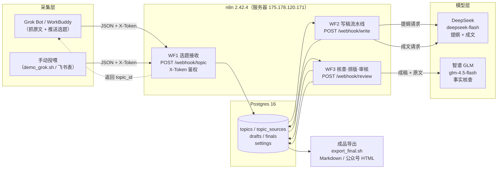
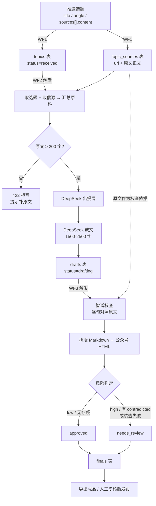
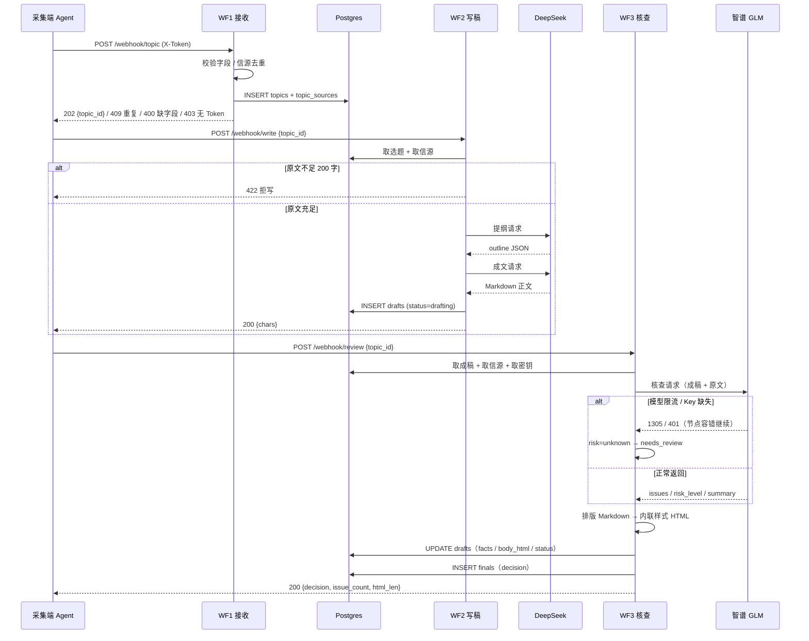
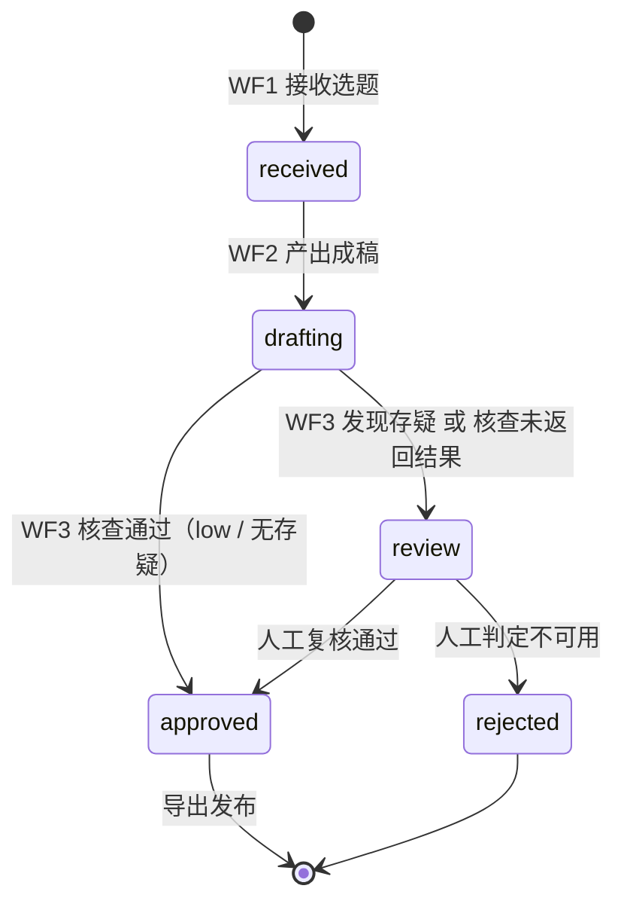

# 架构与交互图

一句话：**采集端把「选题 + 原文全文」推给 n8n，n8n 负责成文、核查、排版、判定，成品落库等待发布。**
n8n 自己不抓网页——国内服务器抓不了海外站点，正文必须由推送方随选题一起带来。

---

## 1. 系统架构

---

## 2. 数据流（一次选题的一生）

---

## 3. 时序图（从推送到成品）

---

## 4. 状态机

| 表 | 字段 | 取值 |
|---|---|---|
| `topics.status` | 选题状态 | `received` |
| `drafts.status` | 成稿状态 | `drafting` → `approved` / `review` |
| `finals.decision` | 成品判定 | `approved` / `needs_review` |

---

## 5. 接口一览

| 方法 | 路径 | 触发 | 成功响应 |
|---|---|---|---|
| POST | `/webhook/topic` | 采集端推送选题 | 202 `{ok, topic_id, source_count}` |
| POST | `/webhook/write` | 对某选题触发写稿 | 200 `{ok, chars}` / 422 原文不足 |
| POST | `/webhook/review` | 对某选题触发核查排版 | 200 `{ok, decision, issue_count}` / 404 无成稿 |

鉴权：仅 `/webhook/topic` 需要 `X-Token`（Webhook 节点 Header Auth，令牌加密存储）。
字段契约与错误码见 [`intake-api.md`](./intake-api.md)。

---

## 6. 三次模型调用

| # | 工作流 | 模型 | 输入 | 输出 | 失败处理 |
|---|---|---|---|---|---|
| 1 | WF2 | DeepSeek `deepseek-flash` | 选题 + 原文素材 | 提纲 JSON | 工作流报错（HTTP 500） |
| 2 | WF2 | DeepSeek `deepseek-flash` | 提纲 + 素材 | Markdown 正文 1500-2500 字 | 工作流报错 |
| 3 | WF3 | 智谱 `glm-4.5-flash` | 成稿 + 原文 | `issues / risk_level / summary` | **容错继续**：risk=unknown → needs_review，不阻塞出稿 |

第 3 步容错是刻意的：核查是"加分项"，不能因为免费档限流就卡住整条流水线。
